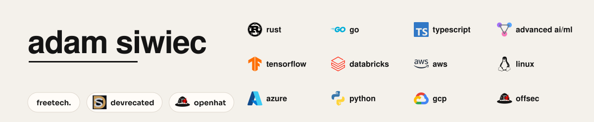
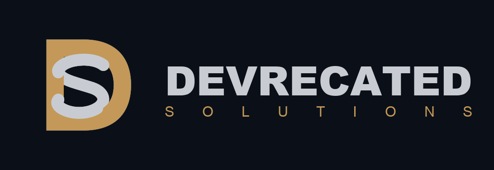
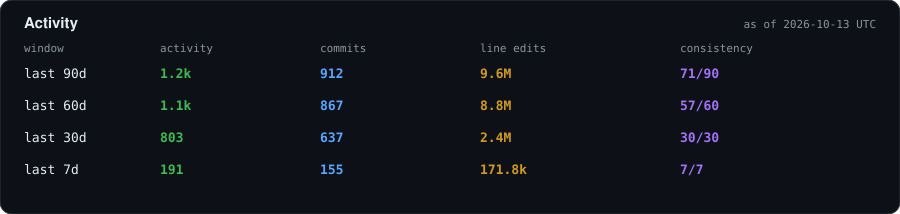

  

I run two companies. **Devrecated Solutions** puts process, gates, and evidence around AI coding agents. **OpenHat Security** does authorized offensive security against an AI-scale attack surface, then leaves the findings, the logs, and the fix.

<table>
<tr>
<td width="50%" align="center" valign="middle">

</td>
<td width="50%" align="center" valign="middle">

</td>
</tr>
</table>

## Activity

  

<!-- activity:start -->

Repos contributed to in the last 90 days (63):

<table>
<tr>
<td valign="middle" nowrap><a href="https://github.com/openhat-security/runhug">runhug</a>&nbsp;<code>152</code></td>
<td valign="middle" nowrap><a href="https://github.com/devrecated/autodevelop">autodevelop</a>&nbsp;<code>147</code></td>
<td valign="middle" nowrap><a href="https://github.com/the-freetech-company/otw-portal-react">otw-portal-react</a>&nbsp;<code>125</code></td>
<td valign="middle" nowrap><a href="https://github.com/openhat-security/ohqs">ohqs</a>&nbsp;<code>37</code></td>
<td valign="middle" nowrap><a href="https://github.com/adamsiwiec1/adamsiwiec1">adamsiwiec1</a>&nbsp;<code>35</code></td>
<td valign="middle" nowrap><a href="https://github.com/openhat-security/oniongate">oniongate</a>&nbsp;<code>34</code></td>
<td valign="middle" nowrap><a href="https://github.com/devrecated/healthcare-marketing-demo">healthcare-marketing-demo</a>&nbsp;<code>32</code></td>
<td valign="middle" nowrap><a href="https://github.com/openhat-security/truffles">truffles</a>&nbsp;<code>32</code></td>
<td valign="middle" nowrap><a href="https://github.com/devrecated/docgen">docgen</a>&nbsp;<code>31</code></td>
<td valign="middle" nowrap><a href="https://github.com/devrecated/autodevelop-cli">autodevelop-cli</a>&nbsp;<code>21</code></td>
<td valign="middle" nowrap><a href="https://github.com/devrecated/devrecated-www">devrecated-www</a>&nbsp;<code>18</code></td>
<td valign="middle" nowrap><a href="https://github.com/openhat-security/ios-max-security">ios-max-security</a>&nbsp;<code>18</code></td>
<td valign="middle" nowrap><a href="https://github.com/openhat-security/runhug-web">runhug-web</a>&nbsp;<code>17</code></td>
<td valign="middle" nowrap><a href="https://github.com/adamsiwiec1/artwork-studio">artwork-studio</a>&nbsp;<code>15</code></td>
<td valign="middle" nowrap><a href="https://github.com/adamsiwiec1/eileen_artwork_gallery">eileen_artwork_gallery</a>&nbsp;<code>14</code></td>
<td valign="middle" nowrap><a href="https://github.com/openhat-security/openhat-www">openhat-www</a>&nbsp;<code>13</code></td>
<td valign="middle" nowrap><a href="https://github.com/devrecated/autodevelop-docs">autodevelop-docs</a>&nbsp;<code>10</code></td>
<td valign="middle" nowrap><a href="https://github.com/openhat-security/.github">.github</a>&nbsp;<code>10</code></td>
<td valign="middle" nowrap><a href="https://github.com/devrecated/acme-portal">acme-portal</a>&nbsp;<code>9</code></td>
<td valign="middle" nowrap><a href="https://github.com/openhat-security/hfpacks">hfpacks</a>&nbsp;<code>8</code></td>
<td valign="middle" nowrap><a href="https://github.com/openhat-security/homebrew-tap">homebrew-tap</a>&nbsp;<code>8</code></td>
<td valign="middle" nowrap><a href="https://github.com/openhat-security/truffles-web">truffles-web</a>&nbsp;<code>8</code></td>
<td valign="middle" nowrap><a href="https://github.com/the-freetech-company/otw-marketing">otw-marketing</a>&nbsp;<code>8</code></td>
<td valign="middle" nowrap><a href="https://github.com/adamsiwiec1/artwork-studio-marketing">artwork-studio-marketing</a>&nbsp;<code>7</code></td>
<td valign="middle" nowrap><a href="https://github.com/devrecated/operations">operations</a>&nbsp;<code>7</code></td>
<td valign="middle" nowrap><a href="https://github.com/adamsiwiec1/editable-website">editable-website</a>&nbsp;<code>6</code></td>
<td valign="middle" nowrap><a href="https://github.com/adamsiwiec1/foss-template">foss-template</a>&nbsp;<code>6</code></td>
<td valign="middle" nowrap><a href="https://github.com/devrecated/sales">sales</a>&nbsp;<code>6</code></td>
<td valign="middle" nowrap><a href="https://github.com/openhat-security/cli-marketing-template">cli-marketing-template</a>&nbsp;<code>5</code></td>
<td valign="middle" nowrap><a href="https://github.com/openhat-security/phishkit">phishkit</a>&nbsp;<code>5</code></td>
<td valign="middle" nowrap><a href="https://github.com/adamsiwiec1/backblaze-b2-backup-audit">backblaze-b2-backup-audit</a>&nbsp;<code>4</code></td>
<td valign="middle" nowrap><a href="https://github.com/devrecated/autodevelop-www">autodevelop-www</a>&nbsp;<code>4</code></td>
<td valign="middle" nowrap><a href="https://github.com/devrecated/discord-api">discord-api</a>&nbsp;<code>4</code></td>
<td valign="middle" nowrap><a href="https://github.com/openhat-security/scoop-bucket">scoop-bucket</a>&nbsp;<code>4</code></td>
<td valign="middle" nowrap><a href="https://github.com/adamsiwiec1/degen-analyzer">degen-analyzer</a>&nbsp;<code>3</code></td>
<td valign="middle" nowrap><a href="https://github.com/adamsiwiec1/rclone-backblaze-b2-setup">rclone-backblaze-b2-setup</a>&nbsp;<code>3</code></td>
<td valign="middle" nowrap><a href="https://github.com/devrecated/.github">.github</a>&nbsp;<code>3</code></td>
<td valign="middle" nowrap><a href="https://github.com/devrecated/features">features</a>&nbsp;<code>3</code></td>
<td valign="middle" nowrap><a href="https://github.com/the-freetech-company/contracts">contracts</a>&nbsp;<code>3</code></td>
<td valign="middle" nowrap><a href="https://github.com/adamsiwiec1/dot-cursor">dot-cursor</a>&nbsp;<code>2</code></td>
<td valign="middle" nowrap><a href="https://github.com/devrecated/README">README</a>&nbsp;<code>2</code></td>
<td valign="middle" nowrap><a href="https://github.com/devrecated/acme-portal-lytenyte">acme-portal-lytenyte</a>&nbsp;<code>2</code></td>
<td valign="middle" nowrap><a href="https://github.com/devrecated/grokbot">grokbot</a>&nbsp;<code>2</code></td>
<td valign="middle" nowrap><a href="https://github.com/devrecated/homebrew-tap">homebrew-tap</a>&nbsp;<code>2</code></td>
<td valign="middle" nowrap><a href="https://github.com/devrecated/layoff-analyzer">layoff-analyzer</a>&nbsp;<code>2</code></td>
<td valign="middle" nowrap><a href="https://github.com/devrecated/scoop-bucket">scoop-bucket</a>&nbsp;<code>2</code></td>
<td valign="middle" nowrap><a href="https://github.com/openhat-security/openhat-search">openhat-search</a>&nbsp;<code>2</code></td>
<td valign="middle" nowrap><a href="https://github.com/openhat-security/packages">packages</a>&nbsp;<code>2</code></td>
<td valign="middle" nowrap><a href="https://github.com/the-freetech-company/bluewire-legal-backup">bluewire-legal-backup</a>&nbsp;<code>2</code></td>
<td valign="middle" nowrap><a href="https://github.com/unslothai/unsloth">unsloth</a>&nbsp;<code>2</code></td>
<td valign="middle" nowrap><a href="https://github.com/adamsiwiec1/awesome-docs-generator">awesome-docs-generator</a>&nbsp;<code>1</code></td>
<td valign="middle" nowrap><a href="https://github.com/adamsiwiec1/chocolatey-packages">chocolatey-packages</a>&nbsp;<code>1</code></td>
<td valign="middle" nowrap><a href="https://github.com/adamsiwiec1/homebrew-tap">homebrew-tap</a>&nbsp;<code>1</code></td>
<td valign="middle" nowrap><a href="https://github.com/adamsiwiec1/monorepo-secret-manager">monorepo-secret-manager</a>&nbsp;<code>1</code></td>
<td valign="middle" nowrap><a href="https://github.com/adamsiwiec1/packages">packages</a>&nbsp;<code>1</code></td>
<td valign="middle" nowrap><a href="https://github.com/adamsiwiec1/scoop-bucket">scoop-bucket</a>&nbsp;<code>1</code></td>
<td valign="middle" nowrap><a href="https://github.com/devrecated/crossfire-demo">crossfire-demo</a>&nbsp;<code>1</code></td>
<td valign="middle" nowrap><a href="https://github.com/devrecated/grokbot-skills">grokbot-skills</a>&nbsp;<code>1</code></td>
<td valign="middle" nowrap><a href="https://github.com/devrecated/packages">packages</a>&nbsp;<code>1</code></td>
<td valign="middle" nowrap><a href="https://github.com/openhat-security/exploitgenie">exploitgenie</a>&nbsp;<code>1</code></td>
<td valign="middle" nowrap><a href="https://github.com/openhat-security/go-cli-packaging-template">go-cli-packaging-template</a>&nbsp;<code>1</code></td>
<td valign="middle" nowrap><a href="https://github.com/term7/MacOS-Privacy-and-Security-Enhancements">MacOS-Privacy-and-Security-Enhancements</a>&nbsp;<code>1</code></td>
<td valign="middle" nowrap><a href="https://github.com/the-freetech-company/otw-fb-marketplace-mcp-testing">otw-fb-marketplace-mcp-testing</a>&nbsp;<code>1</code></td>
</tr>
</table>

<!-- activity:end -->

## Top repositories

Public repos across [adamsiwiec1](https://github.com/adamsiwiec1), [devrecated](https://github.com/devrecated), and [openhat-security](https://github.com/openhat-security), ranked by stars.

<table>
<tr>
<td valign="middle" align="right" width="28"><strong>1</strong></td>
<td valign="middle" width="28"></td>
<td valign="middle"><a href="https://github.com/adamsiwiec1/mcp-sse-authenticated-cloud-run"><strong>mcp-sse-authenticated-cloud-run</strong></a> · TypeScript · MCP over SSE on Cloud Run, IAM auth</td>
<td valign="middle" align="right" width="88"> 23</td>
</tr>
<tr>
<td valign="middle" align="right"><strong>2</strong></td>
<td valign="middle"></td>
<td valign="middle"><a href="https://github.com/adamsiwiec1/monorepo-secret-manager"><strong>monorepo-secret-manager</strong></a> · TypeScript · Sync secrets across a monorepo</td>
<td valign="middle" align="right"> 5</td>
</tr>
<tr>
<td valign="middle" align="right"><strong>3</strong></td>
<td valign="middle"></td>
<td valign="middle"><a href="https://github.com/adamsiwiec1/stockPredictionsML"><strong>stockPredictionsML</strong></a> · Python · Stock prediction model on yfinance</td>
<td valign="middle" align="right"> 5</td>
</tr>
<tr>
<td valign="middle" align="right"><strong>4</strong></td>
<td valign="middle"></td>
<td valign="middle"><a href="https://github.com/adamsiwiec1/SQLStockScraper"><strong>SQLStockScraper</strong></a> · Python · yfinance indicators into SQL</td>
<td valign="middle" align="right"> 3</td>
</tr>
<tr>
<td valign="middle" align="right"><strong>5</strong></td>
<td valign="middle"></td>
<td valign="middle"><a href="https://github.com/adamsiwiec1/powershell-scripts"><strong>powershell-scripts</strong></a> · PowerShell · Collection of PowerShell scripts</td>
<td valign="middle" align="right"> 3</td>
</tr>
</table>

## Devrecated Solutions 

More business. Fewer engineers.

Autodevelop is a governed development system, sold as a service or in pieces. People who use the product open tickets. A developer stays in the editor and guides the pass. Agents plan against acceptance criteria, implement the change, and run ship gates in CI, so a model cannot talk its way past a check. What shipped comes back with evidence. Every subscription includes developer hours to keep that process fitted to the stack.

The pieces are [Autodevelop](https://www.devrecated.com/products/autodevelop), [DocPuppet](https://www.devrecated.com/products/doc-puppet), [LayoffAnalyzer](https://www.devrecated.com/products/layoff-analyzer), [MobileNinja](https://www.devrecated.com/products/mobile-ninja), [RiskAuditor](https://www.devrecated.com/products/risk-auditor), [VibeKiller](https://www.devrecated.com/products/vibe-killer), and [ExploitGenie](https://www.devrecated.com/products/exploit-genie) with OpenHat.

### Sites

<table>
<tr>
<td valign="middle"><a href="https://www.devrecated.com"> devrecated.com</a></td>
<td>Governed AI development systems</td>
</tr>
<tr>
<td valign="middle"><a href="https://www.devrecated.com/about"> About</a></td>
<td>How the practice is set up</td>
</tr>
<tr>
<td valign="middle"><a href="https://www.devrecated.com/blog"> Writing</a></td>
<td>Long form for operators</td>
</tr>
<tr>
<td valign="middle"><a href="https://www.devrecated.com/contact"> Contact</a></td>
<td><a href="mailto:sales@devrecated.com">sales@devrecated.com</a></td>
</tr>
<tr>
<td valign="middle"><a href="https://calendly.com/seth-devrecated/30min"> Book a call</a></td>
<td>Thirty minutes</td>
</tr>
<tr>
<td valign="middle"><a href="https://www.devrecated.com/products"> Products</a></td>
<td>One system, sold whole or in pieces</td>
</tr>
<tr>
<td valign="middle"><a href="https://www.devrecated.com/products/autodevelop"> Autodevelop</a></td>
<td>Tickets, gates, evidence, delivered as a service</td>
</tr>
<tr>
<td valign="middle"><a href="https://www.devrecated.com/products/doc-puppet"> DocPuppet</a></td>
<td>Release evidence for a running application</td>
</tr>
<tr>
<td valign="middle"><a href="https://www.devrecated.com/products/layoff-analyzer"> LayoffAnalyzer</a></td>
<td>A 0–100 read on delivery efficiency</td>
</tr>
<tr>
<td valign="middle"><a href="https://www.devrecated.com/products/mobile-ninja"> MobileNinja</a></td>
<td>Store deploys without the certificate grind</td>
</tr>
<tr>
<td valign="middle"><a href="https://www.devrecated.com/products/risk-auditor"> RiskAuditor</a></td>
<td>One auditor for every code movement</td>
</tr>
<tr>
<td valign="middle"><a href="https://www.devrecated.com/products/vibe-killer"> VibeKiller</a></td>
<td>Screen tweaks from people who are not engineers</td>
</tr>
<tr>
<td valign="middle"><a href="https://www.devrecated.com/products/exploit-genie"> ExploitGenie</a></td>
<td>Authorized testing with OpenHat</td>
</tr>
<tr>
<td valign="middle"><a href="https://www.devrecated.com/try"> Live demo</a></td>
<td>Type a change. Watch a real application update.</td>
</tr>
<tr>
<td valign="middle"><a href="https://devrecated.github.io/autodevelop-docs/"> Handbook</a></td>
<td>Install, CLI, GitHub App, tickets, mail, ship gates</td>
</tr>
<tr>
<td valign="middle"><a href="https://acme-portal-five.vercel.app"> Acme Fleet</a></td>
<td>Dealer portal sandbox</td>
</tr>
<tr>
<td valign="middle"><a href="https://acme-portal-lytenyte.vercel.app"> Acme Fleet, LyteNyte</a></td>
<td>Same portal, LyteNyte grids</td>
</tr>
<tr>
<td valign="middle"><a href="https://healthcare-demo.devrecated.com"> Acme Healthcare</a></td>
<td>Marketing demo built from a meeting transcript</td>
</tr>
</table>

### Repositories

<table>
<tr>
<td width="50%" valign="top">

 
<a href="https://github.com/devrecated/autodevelop-docs"><strong>autodevelop-docs</strong></a> 
Public handbook. Install, CLI, GitHub App, tickets, mail, and ship gates. PolyForm Noncommercial 1.0.0. 
<a href="https://devrecated.github.io/autodevelop-docs/">Handbook site</a>

</td>
<td width="50%" valign="top">

 
<a href="https://github.com/devrecated/autodevelop-cli"><strong>autodevelop-cli</strong></a> 
Customer CLI, <code>@devrecated/autodevelop</code>. Built from the monorepo. PolyForm Noncommercial 1.0.0.

</td>
</tr>
<tr>
<td width="50%" valign="top">

 
<a href="https://github.com/devrecated/acme-portal"><strong>acme-portal</strong></a> 
Autodevelop demo. GitHub Projects, tickets, and confirmed stakeholder mail. 
<a href="https://acme-portal-five.vercel.app">Live portal</a>

</td>
<td width="50%" valign="top">

 
<a href="https://github.com/devrecated/acme-portal-lytenyte"><strong>acme-portal-lytenyte</strong></a> 
The same dealer portal, with LyteNyte grids. 
<a href="https://acme-portal-lytenyte.vercel.app">Live portal</a>

</td>
</tr>
<tr>
<td width="50%" valign="top">

 
<a href="https://github.com/devrecated/healthcare-marketing-demo"><strong>healthcare-marketing-demo</strong></a> 
Acme Healthcare. Built with Autodevelop in under an hour, from three prompts and a meeting transcript. 
<a href="https://healthcare-demo.devrecated.com">Live site</a>

</td>
<td width="50%" valign="top">

 
<a href="https://github.com/devrecated/grokbot-skills"><strong>grokbot-skills</strong></a> 
Reusable skills for Grok Bot, starting with DaVinci Resolve. MIT.

</td>
</tr>
</table>

Packaging for the CLI: [Homebrew tap](https://github.com/devrecated/homebrew-tap) · [Scoop bucket](https://github.com/devrecated/scoop-bucket) · [apt and dnf packages](https://github.com/devrecated/packages)

## OpenHat Security 

Pay us to hack you.

OpenHat runs authorized, AI-powered, human-guided penetration tests. The package is a flat $1,000, with a 24–72 hour turnaround and logs of everything touched. A Critical finding comes with a step-by-step remediation guide. The fee comes back when we do not land one. Written permission from the owner comes before any of that work. Most of the arsenal is open source.

### Sites

<table>
<tr>
<td valign="middle"><a href="https://openhat.devrecated.com"> openhat.devrecated.com</a></td>
<td>Company site</td>
</tr>
<tr>
<td valign="middle"><a href="https://openhat-website.vercel.app"> openhat-website.vercel.app</a></td>
<td>Same site, Vercel host</td>
</tr>
<tr>
<td valign="middle"><a href="https://openhat.devrecated.com/how-it-works"> How it works</a></td>
<td>Intake, authorization, test, findings</td>
</tr>
<tr>
<td valign="middle"><a href="https://openhat.devrecated.com/package"> The package</a></td>
<td>Flat fee, money back if no Critical</td>
</tr>
<tr>
<td valign="middle"><a href="https://openhat.devrecated.com/intake"> Intake</a></td>
<td>Start an engagement</td>
</tr>
<tr>
<td valign="middle"><a href="https://openhat.devrecated.com/ohqs"> OHQS</a></td>
<td>Quickstart API for an authorized test</td>
</tr>
<tr>
<td valign="middle"><a href="https://openhat.devrecated.com/foss"> FOSS index</a></td>
<td>Public tools</td>
</tr>
<tr>
<td valign="middle"><a href="https://truffles.devrecated.com"> truffles.devrecated.com</a></td>
<td>Find repos. Scan commits. Catch leaked secrets.</td>
</tr>
<tr>
<td valign="middle"><a href="https://openhat.devrecated.com/foss/truffles"> truffles project page</a></td>
<td>On the OpenHat site</td>
</tr>
<tr>
<td valign="middle"><a href="https://www.youtube.com/watch?v=0JUmRQlOUjo"> truffles demo</a></td>
<td>YouTube</td>
</tr>
<tr>
<td valign="middle"><a href="https://runhug.devrecated.com"> runhug.devrecated.com</a></td>
<td>Find a model. Deploy it. Run it for pennies.</td>
</tr>
<tr>
<td valign="middle"><a href="https://openhat.devrecated.com/foss/runhug"> runhug project page</a></td>
<td>On the OpenHat site</td>
</tr>
<tr>
<td valign="middle"><a href="https://www.youtube.com/watch?v=WEnywc8ZJl8"> runhug demo</a></td>
<td>YouTube</td>
</tr>
<tr>
<td valign="middle"><a href="https://openhat.devrecated.com/foss/ohqs"> ohqs project page</a></td>
<td>FOSS quickstart</td>
</tr>
<tr>
<td valign="middle"><a href="https://openhat-security.github.io/oniongate/"> oniongate docs</a></td>
<td>Per-app Tor circuits and onion hosting</td>
</tr>
<tr>
<td valign="middle"><a href="https://openhat-security.github.io/phishkit/"> phishkit docs</a></td>
<td>Authorized awareness kit, alpha</td>
</tr>
<tr>
<td valign="middle"><a href="https://openhat-security.github.io/ios-max-security/"> ios-max-security docs</a></td>
<td>iOS 18.2–26.6</td>
</tr>
</table>

### Repositories

<table>
<tr>
<td width="50%" valign="top">

 
<a href="https://github.com/openhat-security/truffles"><strong>truffles</strong></a> · MIT 
Find GitHub repos at scale. Scan every commit. Catch leaked secrets. 
<a href="https://truffles.devrecated.com">truffles.devrecated.com</a>

</td>
<td width="50%" valign="top">

 
<a href="https://github.com/openhat-security/runhug"><strong>runhug</strong></a> · MIT 
Find a Hugging Face model, deploy it on RunPod or GCP, and run it for pennies. 
<a href="https://runhug.devrecated.com">runhug.devrecated.com</a>

</td>
</tr>
<tr>
<td width="50%" valign="top">

 
<a href="https://github.com/openhat-security/ohqs"><strong>ohqs</strong></a> · GPL-3.0 
OpenHat quickstart. The public core of the authorized testing product. 
<a href="https://openhat.devrecated.com/foss/ohqs">Project page</a>

</td>
<td width="50%" valign="top">

 
<a href="https://github.com/openhat-security/hfpacks"><strong>hfpacks</strong></a> · MIT 
Crawl Hugging Face Hub into runhug category index packs.

</td>
</tr>
<tr>
<td width="50%" valign="top">

 
<a href="https://github.com/openhat-security/oniongate"><strong>oniongate</strong></a> · GPL-3.0 
Desktop app for per-app Tor circuits, onion hosting, and leak checks. 
<a href="https://openhat-security.github.io/oniongate/">Docs</a>

</td>
<td width="50%" valign="top">

 
<a href="https://github.com/openhat-security/ios-max-security"><strong>ios-max-security</strong></a> · MIT 
Max privacy and security settings on iOS 18.2 through 26.6, in under a minute. 
<a href="https://openhat-security.github.io/ios-max-security/">Docs</a>

</td>
</tr>
<tr>
<td width="50%" valign="top">

 
<a href="https://github.com/openhat-security/phishkit"><strong>phishkit</strong></a> · GPL-3.0 
Authorized adversary-in-the-middle and awareness kit. Alpha. Desktop and CLI. 
<a href="https://openhat-security.github.io/phishkit/">Docs</a>

</td>
<td width="50%" valign="top">

 
<a href="https://github.com/openhat-security/go-cli-packaging-template"><strong>go-cli-packaging-template</strong></a> · MIT 
GoReleaser layout for Homebrew, Scoop, apt, dnf, npm, and winget. 
<a href="https://github.com/openhat-security/cli-marketing-template">cli-marketing-template</a>

</td>
</tr>
</table>

Install surfaces: [Homebrew tap](https://github.com/openhat-security/homebrew-tap) · [Scoop bucket](https://github.com/openhat-security/scoop-bucket) · [apt and dnf packages](https://github.com/openhat-security/packages)

## Other open source

Starters and utilities under [adamsiwiec1](https://github.com/adamsiwiec1).

<table>
<tr>
<td width="50%" valign="top">

 
<a href="https://github.com/adamsiwiec1/mcp-sse-authenticated-cloud-run"><strong>mcp-sse-authenticated-cloud-run</strong></a> · MIT 
Host a Model Context Protocol SSE server on Cloud Run, authenticated with IAM.

</td>
<td width="50%" valign="top">

 
<a href="https://github.com/adamsiwiec1/monorepo-secret-manager"><strong>monorepo-secret-manager</strong></a> · MIT 
Sync env files, SSH keys, and TLS bundles across a monorepo to GCP, AWS, Azure, or a local encrypted store. 
<a href="https://www.npmjs.com/package/monorepo-secret-manager">npm</a>

</td>
</tr>
<tr>
<td width="50%" valign="top">

 
<a href="https://github.com/adamsiwiec1/foss-template"><strong>foss-template</strong></a> · MIT 
Starter for a public project: community health files, VitePress docs, and GitHub defaults.

</td>
<td width="50%" valign="top">

 
<a href="https://github.com/adamsiwiec1/awesome-docs-generator"><strong>awesome-docs-generator</strong></a> · MIT 
VitePress and Playwright docs. Git-scoped screenshots and video, plus an optional auth gate.

</td>
</tr>
<tr>
<td width="50%" valign="top">

 
<a href="https://github.com/adamsiwiec1/editable-website"><strong>editable-website</strong></a> · MIT 
Next.js starter. Sign in, click the pencil, edit the page copy. 
<a href="https://editable-website-five.vercel.app">Preview</a>

</td>
<td width="50%" valign="top">

 
<a href="https://github.com/adamsiwiec1/s3Backfiller"><strong>s3Backfiller</strong></a> · MIT 
Copy and transform objects between Amazon S3 buckets. Go.

</td>
</tr>
<tr>
<td width="50%" valign="top">

 
<a href="https://github.com/adamsiwiec1/backblaze-b2-backup-audit"><strong>backblaze-b2-backup-audit</strong></a> · MIT 
Audit a disk before an rclone backup to Backblaze B2. Junk, redundant checkpoints, and a cost estimate.

</td>
<td width="50%" valign="top">

 
<a href="https://github.com/adamsiwiec1/rclone-backblaze-b2-setup"><strong>rclone-backblaze-b2-setup</strong></a> · MIT 
Connect rclone to Backblaze B2 in one command, then verify the remote. macOS, Linux, and Windows.

</td>
</tr>
</table>

foss-template packaging examples: [Homebrew tap](https://github.com/adamsiwiec1/homebrew-tap) · [Scoop bucket](https://github.com/adamsiwiec1/scoop-bucket) · [packages](https://github.com/adamsiwiec1/packages) · [Chocolatey](https://github.com/adamsiwiec1/chocolatey-packages)

## Contributions

<table>
<tr>
<td width="50%" valign="top">

<a href="https://github.com/unslothai/unsloth/pull/9361"><strong>unslothai/unsloth</strong></a> · Apache-2.0 
Don't reuse a leftover incomplete isolated Node tree. Merged.

</td>
<td width="50%" valign="top">

<a href="https://github.com/unslothai/unsloth/pull/9363"><strong>unslothai/unsloth</strong></a> · Apache-2.0 
Document sharing models and projects across login users. Merged.

</td>
</tr>
<tr>
<td colspan="2" valign="top">

<a href="https://github.com/term7/MacOS-Privacy-and-Security-Enhancements/pull/3"><strong>term7/MacOS-Privacy-and-Security-Enhancements</strong></a> · GPL-3.0 
SpoofMAC drops the MacPorts and Node dependency and randomizes the MAC with macOS built-ins. Merged.

</td>
</tr>
</table>

<a href="mailto:sales@devrecated.com"> sales@devrecated.com</a>
&nbsp;&nbsp;
<a href="mailto:admin@devrecated.com"> admin@devrecated.com</a>
