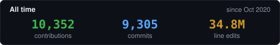
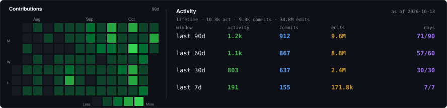

  

&nbsp;&nbsp;<b>From idea to production in days.</b>

***My core expertise is implementing full-stack, data-driven, artificial intelligence and machine learning enhanced software solutions customized to the unique needs of my clients.*** 

Founder of Devrecated Solutions and OpenHat Security, which are my current priorities. 

Previously, Founder of FreeTech, a traditional software agency, who served clients in a variety of industries between March '21 - September '26. FreeTech surpasses 1M ARR in May 24', up from around 400k ARR in 23', following me joining my team full time as CEO in December '23. FreeTech reached it's shelf life in Q3 '26, along with all traditional software in my opinion, which is when I founded Devrecated and OpenHat.

Devrecated still enables clients with software Solutions, similar to FreeTech, except, the methodology and strategy is much more advanced, tailored directly and specifically to each individual client in a manner not offered by any software solutions provider worldwide. 

How can I say this with certainty? Because what we offer hasn't existed until very recently. I've spent 1000s of hours, and have been trying to build a product like AutoDevelop, our flagship product offered at Devrecated Solutions, for over 3 years now. 

I failed, time and time again, until recently when several sets of new technologies were released. These recent advancements, combined with my diverse knowledge of solutions across the industry, along with the variety of methodologies I've implemented over the years throughout my R&D, are what made our vision possible. Learn more at [devrecated.com](https://devrecated.com].

<table>
<tr>
<td valign="middle" width="210">

</td>
<td valign="middle" width="210">

</td>
<td valign="middle">

</td>
</tr>
</table>

## Activity

<!-- activity:start -->

<!-- activity:end -->

## Top repositories

Public repos across [adamsiwiec1](https://github.com/adamsiwiec1), [devrecated](https://github.com/devrecated), and [openhat-security](https://github.com/openhat-security), ranked by stars.

<table>
<tr>
<td valign="middle" align="right" width="28"><strong>1</strong></td>
<td valign="middle" width="28"></td>
<td valign="middle"><a href="https://github.com/adamsiwiec1/mcp-sse-authenticated-cloud-run"><strong>mcp-sse-authenticated-cloud-run</strong></a> · TypeScript · MCP over SSE on Cloud Run, IAM auth</td>
<td valign="middle" align="right" width="88"> 23</td>
</tr>
<tr>
<td valign="middle" align="right"><strong>2</strong></td>
<td valign="middle"></td>
<td valign="middle"><a href="https://github.com/adamsiwiec1/monorepo-secret-manager"><strong>monorepo-secret-manager</strong></a> · TypeScript · Sync secrets across a monorepo</td>
<td valign="middle" align="right"> 5</td>
</tr>
<tr>
<td valign="middle" align="right"><strong>3</strong></td>
<td valign="middle"></td>
<td valign="middle"><a href="https://github.com/adamsiwiec1/stockPredictionsML"><strong>stockPredictionsML</strong></a> · Python · Stock prediction model on yfinance</td>
<td valign="middle" align="right"> 5</td>
</tr>
<tr>
<td valign="middle" align="right"><strong>4</strong></td>
<td valign="middle"></td>
<td valign="middle"><a href="https://github.com/adamsiwiec1/SQLStockScraper"><strong>SQLStockScraper</strong></a> · Python · yfinance indicators into SQL</td>
<td valign="middle" align="right"> 3</td>
</tr>
<tr>
<td valign="middle" align="right"><strong>5</strong></td>
<td valign="middle"></td>
<td valign="middle"><a href="https://github.com/adamsiwiec1/powershell-scripts"><strong>powershell-scripts</strong></a> · PowerShell · Collection of PowerShell scripts</td>
<td valign="middle" align="right"> 3</td>
</tr>
</table>

<!-- contributed:end -->

## Open Source Contributions

| Project | Contribution | PR(s) | Status |
|---|---|---|---|
| [unslothai/unsloth](https://github.com/unslothai/unsloth) | Don't reuse a leftover incomplete isolated Node tree; document sharing models and projects across login users | [#9361](https://github.com/unslothai/unsloth/pull/9361) · [#9363](https://github.com/unslothai/unsloth/pull/9363) | Merged |
| [eugenioenko/ttt](https://github.com/eugenioenko/ttt) | Route Copy/Cut to the focused input; git gutter compares against the index; ask before Save As replaces a dangling link | [#969](https://github.com/eugenioenko/ttt/pull/969) · [#951](https://github.com/eugenioenko/ttt/pull/951) · [#926](https://github.com/eugenioenko/ttt/pull/926) | Merged |
| [term7/MacOS-Privacy-and-Security-Enhancements](https://github.com/term7/MacOS-Privacy-and-Security-Enhancements) | SpoofMAC randomizes the MAC with macOS built-ins, no MacPorts/Node | [#3](https://github.com/term7/MacOS-Privacy-and-Security-Enhancements/pull/3) | Merged |

## Devrecated Solutions 

**More business. Fewer engineers.** [Autodevelop](https://www.devrecated.com/products/autodevelop) is a governed development system, sold whole or in pieces: users open tickets, agents plan against acceptance criteria and implement, ship gates in CI keep models honest, and every change comes back with evidence. Developer hours are included.

**Products:** [Autodevelop](https://www.devrecated.com/products/autodevelop) · [DocPuppet](https://www.devrecated.com/products/doc-puppet) · [LayoffAnalyzer](https://www.devrecated.com/products/layoff-analyzer) · [MobileNinja](https://www.devrecated.com/products/mobile-ninja) · [RiskAuditor](https://www.devrecated.com/products/risk-auditor) · [VibeKiller](https://www.devrecated.com/products/vibe-killer) · [ExploitGenie](https://www.devrecated.com/products/exploit-genie) 
**Site:** [devrecated.com](https://www.devrecated.com) · [About](https://www.devrecated.com/about) · [Writing](https://www.devrecated.com/blog) · [Contact](https://www.devrecated.com/contact) · [Book a call](https://calendly.com/seth-devrecated/30min) · [Live demo](https://www.devrecated.com/try) · [Handbook](https://devrecated.github.io/autodevelop-docs/) 
**Demos:** [Acme Fleet](https://acme-portal-five.vercel.app) · [Acme Fleet, LyteNyte](https://acme-portal-lytenyte.vercel.app) · [Acme Healthcare](https://healthcare-demo.devrecated.com)

| Repo | What it is |
|---|---|
| [autodevelop-docs](https://github.com/devrecated/autodevelop-docs) | Public handbook: install, CLI, GitHub App, tickets, mail, ship gates · [site](https://devrecated.github.io/autodevelop-docs/) |
| [autodevelop-cli](https://github.com/devrecated/autodevelop-cli) | Customer CLI, `@devrecated/autodevelop` · [Homebrew](https://github.com/devrecated/homebrew-tap) · [Scoop](https://github.com/devrecated/scoop-bucket) · [apt/dnf](https://github.com/devrecated/packages) |
| [acme-portal](https://github.com/devrecated/acme-portal) · [lytenyte](https://github.com/devrecated/acme-portal-lytenyte) | Autodevelop dealer-portal demo: Projects, tickets, stakeholder mail |
| [healthcare-marketing-demo](https://github.com/devrecated/healthcare-marketing-demo) | Built with Autodevelop in under an hour from three prompts and a transcript |
| [grokbot-skills](https://github.com/devrecated/grokbot-skills) | Reusable Grok Bot skills · MIT |

## OpenHat Security 

**Pay us to hack you.** Authorized, AI-powered, human-guided pentests: flat $1,000, 24–72 hour turnaround, full logs, a remediation guide for any Critical, and your money back if we don't land one. Written owner permission first. Most of the arsenal is open source.

**Site:** [openhat.devrecated.com](https://openhat.devrecated.com) · [How it works](https://openhat.devrecated.com/how-it-works) · [The package](https://openhat.devrecated.com/package) · [Intake](https://openhat.devrecated.com/intake) · [OHQS](https://openhat.devrecated.com/ohqs) · [FOSS index](https://openhat.devrecated.com/foss)

| Repo | What it is |
|---|---|
| [truffles](https://github.com/openhat-security/truffles) | Find GitHub repos at scale, scan every commit, catch leaked secrets · [site](https://truffles.devrecated.com) · [demo](https://www.youtube.com/watch?v=0JUmRQlOUjo) |
| [runhug](https://github.com/openhat-security/runhug) | Find a Hugging Face model, deploy on RunPod or GCP, run it for pennies · [site](https://runhug.devrecated.com) · [demo](https://www.youtube.com/watch?v=WEnywc8ZJl8) |
| [leakcheck](https://github.com/openhat-security/leakcheck) | Scan live websites for leaked API keys and tokens |
| [ohqs](https://github.com/openhat-security/ohqs) | OpenHat quickstart, the public core of the testing product · GPL-3.0 |
| [hfpacks](https://github.com/openhat-security/hfpacks) | Crawl Hugging Face Hub into runhug index packs |
| [oniongate](https://github.com/openhat-security/oniongate) | Per-app Tor circuits, onion hosting, leak checks · [docs](https://openhat-security.github.io/oniongate/) · GPL-3.0 |
| [ios-max-security](https://github.com/openhat-security/ios-max-security) | Max iOS 18.2–26.6 privacy settings in under a minute · [docs](https://openhat-security.github.io/ios-max-security/) |
| [phishkit](https://github.com/openhat-security/phishkit) | Authorized AiTM and awareness kit, alpha · [docs](https://openhat-security.github.io/phishkit/) · GPL-3.0 |
| [go-cli-packaging-template](https://github.com/openhat-security/go-cli-packaging-template) | GoReleaser for Homebrew, Scoop, apt, dnf, npm, winget · [marketing template](https://github.com/openhat-security/cli-marketing-template) |

Install surfaces: [Homebrew](https://github.com/openhat-security/homebrew-tap) · [Scoop](https://github.com/openhat-security/scoop-bucket) · [apt/dnf](https://github.com/openhat-security/packages)

## Other open source

Starters and utilities under <a href="https://github.com/adamsiwiec1">adamsiwiec1</a> (8)

| Repo | What it is |
|---|---|
| [mcp-sse-authenticated-cloud-run](https://github.com/adamsiwiec1/mcp-sse-authenticated-cloud-run) | MCP SSE server on Cloud Run with IAM auth |
| [monorepo-secret-manager](https://github.com/adamsiwiec1/monorepo-secret-manager) | Sync env files, SSH keys, TLS bundles to GCP, AWS, Azure, or local · [npm](https://www.npmjs.com/package/monorepo-secret-manager) |
| [foss-template](https://github.com/adamsiwiec1/foss-template) | Public-project starter: health files, VitePress docs, GitHub defaults |
| [awesome-docs-generator](https://github.com/adamsiwiec1/awesome-docs-generator) | VitePress + Playwright docs with git-scoped screenshots and video |
| [editable-website](https://github.com/adamsiwiec1/editable-website) | Next.js starter: sign in, click the pencil, edit copy · [preview](https://editable-website-five.vercel.app) |
| [s3Backfiller](https://github.com/adamsiwiec1/s3Backfiller) | Copy and transform objects between S3 buckets (Go) |
| [backblaze-b2-backup-audit](https://github.com/adamsiwiec1/backblaze-b2-backup-audit) | Audit a disk before an rclone → B2 backup, with cost estimate |
| [rclone-backblaze-b2-setup](https://github.com/adamsiwiec1/rclone-backblaze-b2-setup) | Connect rclone to B2 in one command (macOS, Linux, Windows) |

Packaging examples: [Homebrew](https://github.com/adamsiwiec1/homebrew-tap) · [Scoop](https://github.com/adamsiwiec1/scoop-bucket) · [packages](https://github.com/adamsiwiec1/packages) · [Chocolatey](https://github.com/adamsiwiec1/chocolatey-packages)

<a href="mailto:sales@devrecated.com"> sales@devrecated.com</a>
&nbsp;&nbsp;&nbsp;
<a href="mailto:admin@devrecated.com"> admin@devrecated.com</a>

